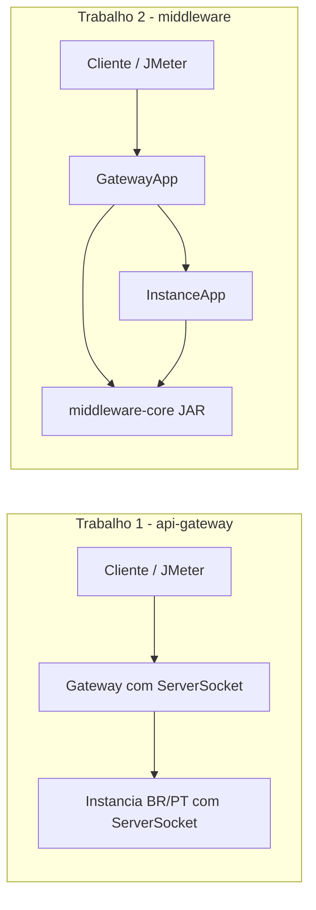
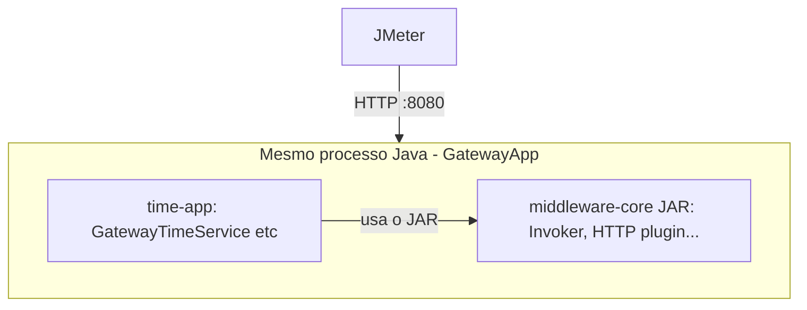
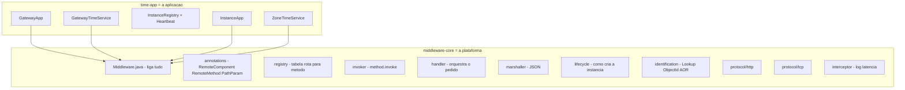
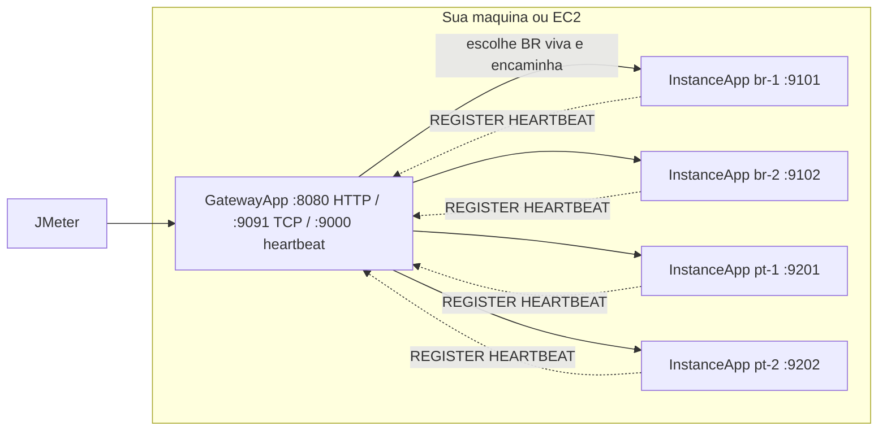
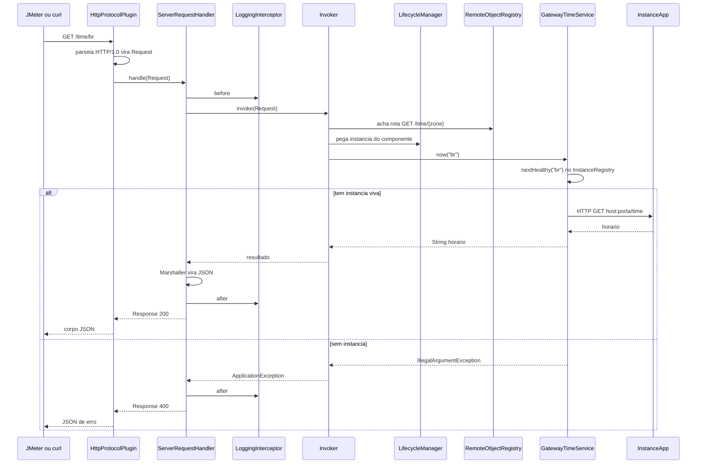
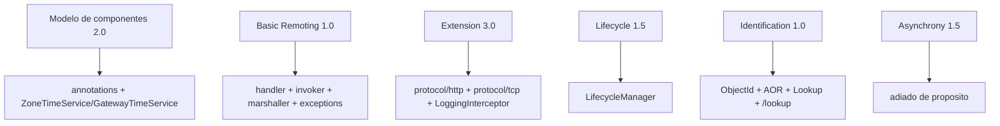

# Como o TP2 funciona (do zero)

Este arquivo existe para uma coisa só: **entender o projeto sem pirar**.

Leia na ordem. Os diagramas abrem no preview do Markdown do Cursor/VS Code / GitHub.

---

## 1. Em uma frase

Você criou uma **biblioteca** (`middleware-core`) que transforma método Java anotado em serviço na rede.

A **aplicação** (`time-app`) usa essa biblioteca — é a mesma ideia do TP1 (horário BR/PT + gateway), só que a rede não é mais escrita na mão na classe de negócio.

**JMeter não fala com o projeto `api-gateway`.** Fala com o `GatewayApp` deste repo.

---

## 2. TP1 vs TP2 (a confusão mais comum)



| | TP1 `api-gateway` | TP2 `middleware` |
|--|-------------------|------------------|
| Entrega deste trabalho | Não (já foi) | **Sim** |
| O que o JMeter chama | Processo do TP1 | **`GatewayApp` do TP2** |
| Como a rede funciona | Sockets na mão em tudo | Middleware (anotações + Invoker + plugins) |
| Relação entre eles | — | TP2 **refaz a mesma aplicação**, não chama o TP1 |

O PDF manda: *mesma aplicação da 1ª unidade, mas classes de negócio com anotações, e cada componente importa o JAR*. É isso que o `time-app` faz.

---

## 3. Dois projetos no IDE, um processo na hora de rodar

Isso é a figura do PDF.



- No **IDE**: `middleware-core` e `time-app` são módulos separados.
- No **Maven**: `time-app` depende do JAR do `middleware-core`.
- No **SO**: `java ... GatewayApp` = **um** processo com as duas coisas no classpath.

Instâncias (`InstanceApp`) são **outros processos** (como no TP1). A figura do PDF mostra o caso mínimo; a arquitetura completa parece o TP1.

---

## 4. Para que serve o middleware?

Sem middleware (TP1):

```text
pedido HTTP → você parseia → if /time/br → devolve horário
```

Com middleware (TP2):

```text
você escreve só:

  @RemoteMethod(path = "/time/{zone}")
  public String now(String zone) { ... }

o middleware: escuta porta, acha o método, chama, responde
```

É o “motor” por trás de Spring/gRPC, só que feito por você para a disciplina.

---

## 5. Mapa mental das pastas



**Regra de ouro**

- Pasta `middleware-core` → padrões da disciplina (Invoker, Marshaller…).
- Pasta `time-app` → negócio (horário, gateway, LB).

---

## 6. O que roda na demo completa



Sem instâncias saudáveis, o gateway responde com **erro (HTTP 400)** — no JMeter a taxa de erro tende a ~100%. Com instâncias, faz load balance e encaminha.

---

## 7. Caminho de UM pedido HTTP (o mais importante)

Exemplo: `GET http://127.0.0.1:8080/time/br`



### Em português, passo a passo

1. **JMeter/curl** manda `GET /time/br` na 8080.
2. **`HttpProtocolPlugin`** (middleware) aceita o socket e monta um `Request`.
3. **`ServerRequestHandler`** chama interceptors e o Invoker.
4. **`RemoteObjectRegistry`** já sabe (desde o `register`) que  
   `GET /time/{zone}` → `GatewayTimeService.now`.
5. **`Invoker`** resolve `@PathParam("zone")` = `"br"` e faz `method.invoke`.
6. **`GatewayTimeService`** (app) escolhe uma instância BR no registry (LB).
7. Encaminha para a instância; se não houver saudável, lança erro (HTTP 400).
8. Volta: Marshaller → Response → bytes HTTP → cliente.

TCP é a mesma ideia: linha `TIME br` vira um `Request` GET `/time/br` e segue o mesmo Invoker.

---

## 8. Como as anotações entram nisso

```java
@RemoteComponent(name = "gateway-time", lifecycle = STATIC)
public class GatewayTimeService {

  @RemoteMethod(path = "/time/{zone}", httpMethod = GET)
  public String now(@PathParam("zone") String zone) { ... }
}
```

| Anotação | Significa |
|----------|-----------|
| `@RemoteComponent` | Esta classe é um objeto remoto |
| `@RemoteMethod` | Este método pode ser chamado pela rede nesta rota |
| `@PathParam` | Este argumento vem do path (`br` em `/time/br`) |

No `mw.register(obj)`, o middleware **varre** esses métodos e monta a tabela de rotas. Sem anotação, o método não existe para a rede.

---

## 9. Critérios da nota ↔ onde está no código



---

## 10. O que você sobe na apresentação

### Mínimo (já impressiona)

```powershell
mvn clean install
# classpath como no README
java ... br.imd.ufrn.app.GatewayApp
java ... br.imd.ufrn.app.instance.InstanceApp br br-1 9101
curl http://127.0.0.1:8080/time/br
# JMeter carga-http.jmx
```

### Completo (igual espírito do TP1)

1. Terminal: `GatewayApp`
2. Terminais: `InstanceApp br br-1 9101`, `br-2`, `pt-1`, `pt-2`
3. JMeter batendo no gateway
4. Se pedirem “mata uma instância”: **Ctrl+C** no terminal dela  
   → heartbeat para → gateway remove → LB usa as outras (erro sobe, sem tender a 100%)
5. Se pedirem “mata todas”: derruba as restantes → erro tende a ~100%; religa → erro cai

> Ops `POST/DELETE` na **8081** (`InstanceManagerServer`) sobe/derruba instâncias como no TP1.
> Durante o JMeter: `DELETE {"id":"br-1"}` — o heartbeat para e o gateway tira a réplica do LB.

---

## 11. Checklist “eu entendi?”

Se você souber responder isto, está ok para a disciplina:

1. **Por que dois módulos?** Um é a plataforma (JAR), outro é a app — exigência do PDF.  
2. **JMeter chama quem?** `GatewayApp` do TP2, porta 8080.  
3. **Onde está a regra de negócio?** `time-app` (`GatewayTimeService`, `ZoneTimeService`).  
4. **Onde está a “mágica” de rede?** `middleware-core`.  
5. **O `api-gateway` entra na demo?** Não. É só o ancestral do TP1.  
6. **O que é Invoker?** Quem acha o método anotado e chama com reflexão.  

---

## 12. Frase para guardar

> TP1 = eu *era* o middleware (sockets em tudo).  
> TP2 = eu *escrevi* o middleware e a app só declara objetos remotos.

Se travar de novo, volte na **seção 7** (caminho do `GET /time/br`). É o coração do trabalho.
